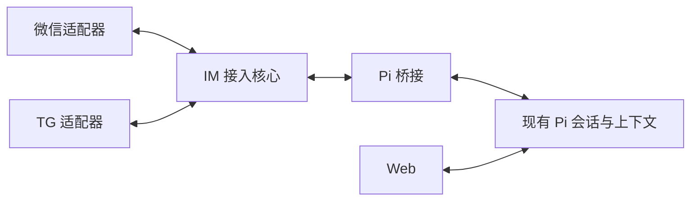

# IM 私聊接入契约

本轮先完善现有私聊接入的职责与消息契约，以微信和 TG 已有私聊流程验证。现有功能与限制以 [README.md](README.md) 为准，模块接入规则见 [AGENTS.md](AGENTS.md)。

管理员、新的响应权限管理指令、命令菜单和按钮流程暂不展开，待出现实际需求后再设计；这些事项不作为私聊工作的前置条件。

## 1. 已确认的边界

- Pi 是唯一的会话与上下文基座，负责历史、压缩、分支及模型和工具执行。
- 沿用现有授权入口；IM 接入核心统一协调获准消息、项目和 Pi 会话关联及本次回复归属。
- 适配器自行维护授权、连接、重连、票据、游标及媒体传输等协议状态；核心通过统一接口控制启停、接收状态。
- 私聊消息交给关联的普通 Pi 会话；不在 IM 中另建模型历史、上下文管理器或执行引擎。
- IM 指令以接入管理为主。Pi 原生命令、操作和扩展命令默认不开放；仅允许设计明确接线的指定能力，不自动同步目录或任意透传。
- Web 显示整个 Pi 会话。IM 只接收本次请求归属明确的回复，共享会话不产生跨渠道广播。

## 2. 本轮范围

| 本轮保留并收敛的能力 | 本轮不扩展的内容 |
| --- | --- |
| 微信及 TG 已有私聊收发 | 新渠道接入及平台能力齐平 |
| 微信已有图片、文件、语音转写及引用输入 | TG 新媒体能力、视频及原生语音发送 |
| 现有授权名单、项目配置及会话关联 | 管理员模型和新的权限配置指令 |
| 现有 IM 指令及明确的原生能力接线 | 新命令、原生命令目录同步、菜单和按钮工作流 |
| 来源 Meta、Web 角标、原聊天回复 | 跨渠道广播、重启补发及独立消息历史库 |
| 现有等待、停止、连接恢复及遥测 | 新任务监督系统、额外限流或重试机制 |

TG 已有群聊及 Topic 行为仍需保持兼容，不因本轮聚焦私聊而禁用或删减；本轮不新增群聊策略，也不以群管理设计阻塞私聊工作。已有 `isGroup`、`threadId` 等信息继续保留。

## 3. 职责与依赖方向

| 部分 | 职责 | 交给下一层的内容 |
| --- | --- | --- |
| 适配器 | 平台配置和登录、协议验真、连接、收件解析、媒体传输、格式呈现 | 已解析的消息、能力及连接状态；发送结果 |
| IM 接入核心 | 接收已按现有规则获准的消息、项目及会话关联、去重、接入排队与取消、请求和回复关联 | 本次获准输入及捕获的回复目标 |
| Pi 桥接 | 复用既有 wrapper 创建或恢复会话，转换并提交本次输入，记录来源，接收对应结果 | 归属明确的回答及可交付附件引用 |
| Pi 基座 | 会话、历史、上下文、分支、模型及工具执行 | Pi 原生会话与执行事件 |

Pi 桥接依据通用输入与实际交付能力工作，不根据渠道名称决定微信专用处理。渠道加密、上传、票据、文本格式和输入状态协议留在适配器。

现有 IM 队列只协调输入与投递时机，Pi 的执行仍由既有 wrapper 和 SDK 管理；不新增一套会话注册表、锁或执行调度。

## 4. 私聊输入契约

### 4.1 来源与地址

私聊消息需要保留渠道、内部 `botId`、聊天 ID、发送者 ID、收件标识和平台消息 ID，以及适用的现有话题字段。

内部机器人 ID 与平台账号 ID 分开；收件标识与原生消息 ID 分开。TG 的 `update_id` 不作为 `message_id` 保存，现有来源 Meta 的含义保持不变。

核心捕获本次回复目标，不根据最后一条消息或当前 Web 选择的会话推测目的地。发送票据及能力地址由适配器管理，不进入模型、来源 Meta 或角标数据。

私聊沿用现有授权：微信只接受绑定主人；TG 使用已有允许用户和可选聊天名单。不把这些允许用户另行转成管理员角色。

### 4.2 消息内容

沿用 `ImInbound` 的 `text`、`attachments` 和 `quotedText` 表达本次文本、按序附件及独立引用，不引入第二套消息历史格式。内容种类限于已实现的文本、图片和文件；平台提供的语音转写保留其来源含义。

引用独立表达原消息及平台实际提供的摘录，引用或附件中的命令文本不触发 IM 控制。没有引用原文时不编造内容。

Pi 桥接将本次内容转换为 Pi 原生输入：图片走既有图片入口，文件提供已落盘的准确引用，引用内容作为本次输入的辅助信息。这个过程不读取并重建另一份聊天历史。

协议媒体准备仍在适配器内执行，通过现有可取消的准备入口与核心队列配合，避免下载阻塞后续收件和停止指令。

本轮先用已有微信多媒体消息及 TG 文字私聊检验契约，不要求两渠道实现相同的媒体能力。

### 4.3 模型侧的请求上下文

来源记录、模型感知与回复投递分别承担不同职责。完整来源 Meta 留给宿主记录和路由；模型只需要本次渠道、私聊/群聊/Topic 以及实际支持的回复能力，不接收平台票据或投递地址。

Pi 桥接把来源和能力登记在本次 requestId 下，通过 SDK 公开 `agent.transformContext` 串联原转换，在每次模型调用时投影系统说明，不把渠道说明或附件交付约定拼进用户正文，也不另存一份模型历史。不返回冻结整段提示词的 forced prompt，保留原有 exact prompt 和运行中工具声明、snippet、guidelines 的更新。

每次投影按原始上下文中最后一条 user 消息匹配有效请求；仍在等待回复的子代理 custom 续跑可以沿用，完成、拒绝或取消后释放。运行中 Web steer/follow-up、新一轮 Web 或其他渠道输入重新确定本次上下文，不将共享会话或整个工具循环固定成某渠道。

模型据此组织答复，原聊天投递继续由 IM 核心和适配器执行，不依赖模型自行选择发送对象。已有历史正文不自动迁移或改写。

## 5. Pi 会话关联与结果归属

机器人继续绑定项目目录，外部聊天通过现有 `[botId, chatId, threadId]` 关联普通 Pi 会话。有效关联继续使用；没有关联时通过 Pi 桥接创建，不猜测最近会话。

私聊身份不等于 Pi 会话身份；两个聊天仅在显式绑定时共享 Pi 会话。共享绑定意味着共享该 Pi 会话的上下文，原路回复只控制投递目的地。

沿用当前等待 Web 任务结束、关联具体输入及校验输出归属的流程。归属不明确时提示去 Web 查看，不把混合结果回给 IM。

`pi-web:im-source` 继续关联实际用户消息，保留实时、历史和 fork／clone 的来源投影。统一输入契约不等于现有 v1 来源记录；本轮不为尚未接入的渠道提前更换来源格式。

## 6. 私聊交付契约

Pi 桥接保留最终回答原文，通用输出解析按 `ImReplyCapabilities` 补充附件引用。当前附件回复能力由适配器是否实现 `sendAttachment` 确定，不从来源渠道推断，也不重复声明另一份能力开关。适配器据此形成对应平台的文本和媒体消息，不修改 Web 中的 Pi 原始回答。

微信继续仅从归属明确的最终回答中提取显式本地 Markdown 附件链接，并按原聊天发送。TG 本轮保持现有文字回复，不默认为它启用附件上传或替换其原始链接。

交付关联本次请求和捕获的目标。适配器负责分段、上传和平台呈现。当前发送接口以返回或抛错表示完成与失败，尚未提供统一的平台回执或结果未知类型；请求成功不等于用户端已读。超时或连接中断可能无法判定平台是否已受理，仍沿用不自动重试的策略。

协议回复上下文不可用时返回实际失败，不猜测其他目的地。发送结果未知不自动重试，持久化来源和回复地址不代表已经提供可靠补发。

## 7. 现有指令的边界

本轮仅保留现有入口，不增加管理员或新的命令目录。

| 现有入口 | 保持的行为 |
| --- | --- |
| `/help`、`/start`、`/status` | 返回 IM 用法、项目和关联状态 |
| `/sessions`、`/bind` | 查询或验证项目内普通 Pi 会话，维护关联 |
| `/new` | 解除当前关联，下一条普通输入再通过 Pi 创建会话 |
| `/stop` | 撤掉本聊天待提交输入，并经已有接线停止关联 Pi 会话 |

`/stop` 当前可能停止共享会话中的 Web 任务；本轮保留已有语义，不将其描述为只停止本条 IM 请求，也不以新权限模型作为本轮前置条件。

未接线的 Pi 操作不能作为原生命令执行。现有未知文本的普通输入语义不因本轮改变，不按命令名称调用 Pi 发现或执行接口。

以后若出现原生命令菜单、按钮或新的管理指令需求，再逐项定义动作、权限、参数和结果；只有明确接线的指定 Pi 能力才能被调用。

## 8. 状态与存储所有权

适配器拥有协议状态的生命周期及序列化含义。公共存储可以提供按机器人隔离的保存入口，但核心不解析票据、不控制协议重连步骤。

连接状态、Pi 任务状态和投递结果分别表达。连接状态来自驱动 `onStatus`；最近一次回复投递失败单独通过 `deliveryError` 展示，后续投递成功时清除，不将仍在线的连接标成断线。任务失败沿用原聊天提示与遥测。输入状态继续由核心表达忙碌意图、适配器执行平台协议。

继续使用 `integrations/im/state.json` 保存已有配置、绑定和私有恢复数据。文件权限、单进程持有、凭据隔离和重启恢复策略沿用模块现有约定，不因逻辑边界调整更换存储。

Pi 会话仍是历史与来源记录的唯一基座。遥测沿用现有 CAT 接口及凭据隔离，正常取消不作为异常，外部原始票据和聊天正文不进入错误上报。

## 9. 参考与取舍

本轮借鉴成熟项目的接入设计，优先收敛已有接口，不引入完整 IM 运行时。

- Satori／Koishi：参考消息、聊天地址、账号及适配器生命周期的区分。
- NoneBot2：参考协议通信留在适配器、通用流程消费规范化输入的边界。
- OpenClaw：参考渠道交付与来源、回复目标的分离，不移植其上下文及会话体系。

外部核验快照和证据见记忆系统条目 1151，核验日期为 2026-11-16。新渠道和 SDK 的直接复用成本在有接入需求时再评估。

后续新增渠道允许必要的显式注册、类型和展示接线；不以零改公共文件为目标，也不为未来渠道预建动态插件框架或通用管理工作流。

## 10. 本轮完成标准

1. 微信和 TG 现有私聊沿用已有授权，共享获准输入的收件协调、会话关联和结果归属流程，渠道差异由各自适配器及能力承担。
2. 微信现有文字、媒体、转写、引用及输入状态行为保持，TG 已有文字私聊保持。
3. 通用层与 Pi 桥接不再以渠道名称实现微信专用分支；配置、登录和协议恢复的私有状态由适配器维护。
4. 等待、连续输入、停止、重连和重新进入已有 Pi 会话保持现有含义，回复仍回本次原聊天。
5. Web 原始记录、来源 Meta、角标及 fork／clone 保留；TG 已有群聊和 Topic 不受删减。
6. 验证只围绕真实私聊流程及受影响的兼容行为，不以测试数量、覆盖率或内部源码形状为成果指标。

管理员、群级管理、新管理命令和菜单／按钮交互待实际需求出现后另行讨论；本轮无需为这些事项先做选择。
